

# noah shield

**an aureon software by #houseofasher** · version `2026.11.20.6` · Chrome / Chromium 137+

A tunnel that fails closed instead of leaking, trackers and data grabs stopped on every page,
cheaper prices and working coupons while you shop, and a watch on anything that could record your screen.

 

&nbsp;

One click downloads the zip. The <b>clean</b> build has the same files with normalized timestamps, for reproducible builds and store uploads.

  

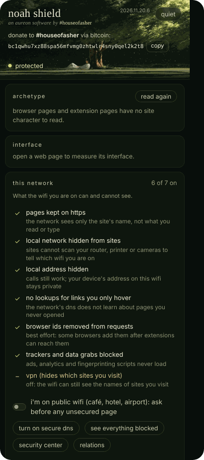

---

## Downloads

| # | File | Use it for | SHA-256 |
|---|------|-----------|---------|
| 1 | [**noah-shield-2026.11.20.6.zip**](noah-shield-2026.11.20.6.zip?raw=true) | Everyday install (load unpacked) | `edb7a5d2b61fe296341c3640deb47e363091cf4d1fc0e5ded33f85e0419f521f` |
| 2 | [**noah-shield-2026.11.20.6.clean.zip**](noah-shield-2026.11.20.6.clean.zip?raw=true) | Store upload / reproducible build | `413f3ca7de3dd675428fa83eb1c68bcbe7ef6319840c2d1f4a4df055e8ac7956` |
| 3 | [noah-shield-2026.11.12.2.zip](noah-shield-2026.11.12.2.zip?raw=true) | Previous release | — |

Both 2026.11.20.6 archives contain byte-identical files; only the zip timestamps differ.

---

## Contents

- [Install workflow](#install-workflow)
- [Capabilities 1 – 20](#capabilities)
- [Architecture diagram](#architecture)
- [Workflows](#workflows)
- [Screenshot gallery](#screenshot-gallery)

---

## Install workflow

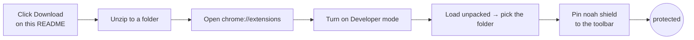

1. Click **Download** above.
2. Unzip it anywhere you'll keep it.
3. Open `chrome://extensions` and switch on **Developer mode**.
4. Click **Load unpacked** and pick the unzipped folder.
5. Pin **noah shield**. The popup should say **protected**.

---

## Capabilities

### 1. Network protection
Guards against whoever runs the wifi you're on: keeps pages on https, stops sites scanning your router, printer and cameras, hides your device's local address (calls still work), skips DNS lookups for links you only hover, strips browser ids from requests, adds a public-wifi mode that asks before any unsecured page, and turns on secure DNS with one click.

### 2. Fail-closed VPN tunnel
Sends all browser traffic through one location you pick. If that location stops answering, requests **stop**; they never fall back to your own connection. Names are resolved at the location and WebRTC can't reveal your real address. Locations come from noah's signed list, your own HTTPS/SOCKS5 servers, or Tor on this computer. Plain http proxies across the internet are refused.

### 3. Ads and tracker blocking
EasyList and EasyPrivacy on every site, about **59,500 network rules** (20,000 ads + 30,000 extra ads + 9,555 trackers), plus a cosmetic stylesheet that removes leftover ad boxes.

### 4. Data protection and permissions
Blocks third-party cookies and deletes tracker cookies twice a day. Denies location and notification prompts. Can deny camera and microphone outright. Strips tracking parameters from links, sends Global Privacy Control and Do Not Track, and disables the browser's ad topics and link prefetching. Supports trusted-site and no-cookie-site lists.

### 5. Fingerprint and location blur
Blurs canvas, WebGL, audio, hardware and battery fingerprints, gives each site a different fingerprint, or blends in as a common Windows / Chrome / 1920×1080 setup, rotating per session, day or hour. You choose the location every site sees: deny it, use your real one, use the tunnel's country, or pick a city. Timezone, language and coordinates follow that choice so they agree with the tunnel's exit.

### 6. Security and account safety
Upgrades every site to https, stops lookalike domains (`paypa1.com`) before they load, warns about reused passwords and passwords sent over plain http, checks passwords against known leaks (Have I Been Pwned k-anonymity, only five hex characters leave the browser), and holds risky downloads until you've read why. It also guards the clipboard, disarms hidden autofill fields, and includes a typing guard, a crypto-wallet guard, and a breaker for fake support pages.

### 7. Security center
An evidence-only console. Every finding comes from something the browser recorded plus a written rule, with no guesswork and no AI. Tabs: **overview · site audit · media cleaner · investigations · network · graph · relations · extensions · files · threat intel · identity · devices**. It ships with a **110-pattern** security library (CWE / CAPEC / ATT&CK mapped) and 69 security network rules, and exports PDF reports.

### 8. Recording watch
Pages must ask before recording the screen or using the camera and microphone. Other extensions that have capture permissions and reach into every site get flagged and weighted, with sideloaded ones weighted higher. You can disable them here, and that's reversible.

### 9. Cookies, history and identity
Burns a site's cookies when its last tab closes, signs you out after idle, and keeps chosen sites out of history. Adds plus-address or SimpleLogin aliases for decoy forms, blurs your name on pages (anti-dox), syncs settings end to end encrypted under your own passphrase, and keeps a permission history.

### 10. Modes
Profiles that flip many switches at once: **browsing** (most private), **shopping** (prices and codes on), and **banking** (strict and plain, other extensions paused while the bank is in front). Also low-data, battery saver, private search (DuckDuckGo, Brave, Startpage, Qwant, Ecosia), local-only mode, and a weekly report.

### 11. Annoyances, focus and control
Answers cookie banners with "reject all", flags dark patterns, removes paywall and newsletter nags, stops autoplay, warns before you paste card numbers or seed phrases, strips photo metadata before upload, and adds dark mode everywhere. **Focus hours** block distracting sites, **tab lock** puts a PIN curtain over idle tabs, **expiring downloads** clean up after themselves, and **parental mode** blocks adult sites and forces safe search behind a PIN.

### 12. Shopping
Compares prices at other stores, collects and auto-tries coupon codes at checkout, clips Amazon coupons, searches independent and foreign shops (converted to your currency), and on medicines notes when a pharma company is behind the brand, with herbal alternatives. Lookups carry no cookies and only the product name. It never places an order.

### 13. Tools
A weekly summary and network status. Also: **where does this link go** (redirect chain), **QR code check**, **read this policy**, **forget me** (people-search and data-broker opt-outs), price-drop watch, receipts and warranties, reminders, and a **notes vault**.

### 14. Footprint
Shows what the web holds about you: searches your name, emails and phones across engines and translates foreign results, with nothing saved unless you ask.

### 15. Optimizer
Drop a file to shrink it locally (jpg, png, webp, gif, svg, pdf, mp3, mp4 and more). Nothing is uploaded.

### 16. Downloader and recorder
The **downloader** finds the media on the current tab and saves it. The **recorder** captures a screen, window or tab, with optional camera bubble, microphone, system sound and countdown.

### 17. Archetype and interface reading
Reads each site's character (archetype) and measures its interface right in the popup.

### 18. Relations side panel
Maps the people, companies and owners behind a page into a relationship graph in the browser side panel.

### 19. Social and AI
Social tools for **X / Twitter** (profile intel, Spaces), **Instagram**, **TikTok**, **Reddit**, **YouTube** (ad skipping) and **LinkedIn**. The **shepherd persona** can be applied on every AI chat site. **Inspect mode** lets you stress-test your own site or platform.

### 20. The look, new tab and diagnostics
Seven looks (pasture, sea, lights, meteor, halo, rings, glitch), a calm new-tab page with a clock and search, a full **log** of everything blocked or warned about, and a **leak test** that checks where traffic comes out and whether WebRTC leaks your address.

---

## Architecture

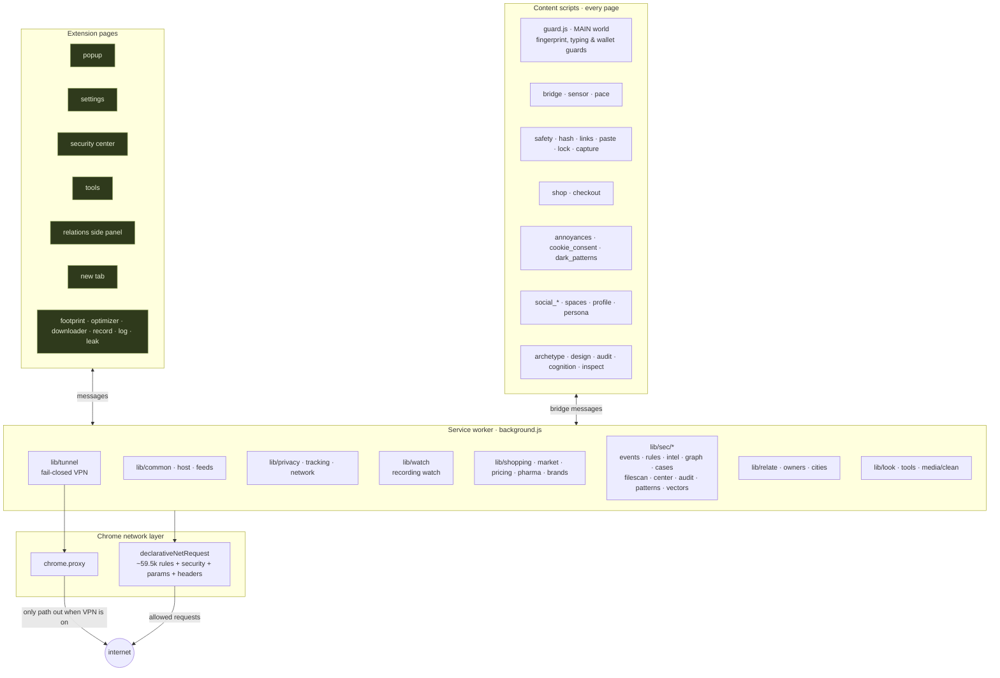

---

## Workflows

### A. Every request: what happens to a page load

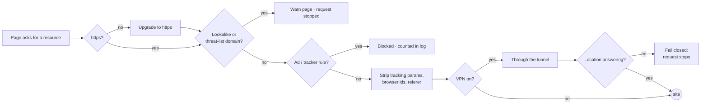

### B. Security center: from event to investigation

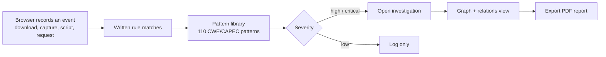

### C. Shopping at checkout

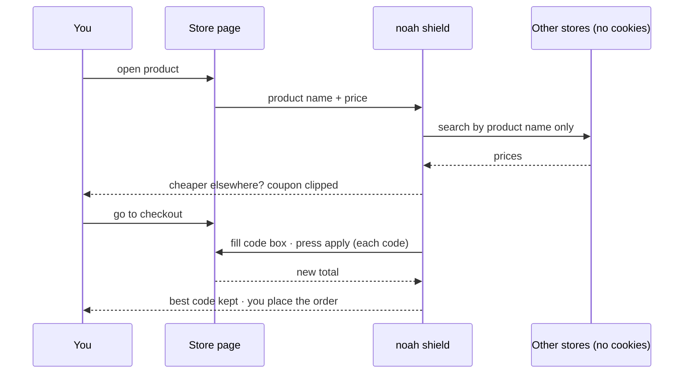

### D. Recording watch

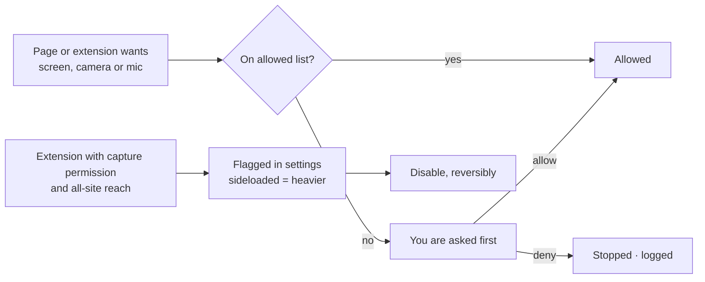

---

## Screenshot gallery

Shown in the same order as the capabilities.

| # | Screen | |
|---|--------|---|
| 1–2, 17 | **Popup**: network status, VPN, archetype, interface |  |
| 1–6, 9–12 | **Settings** | 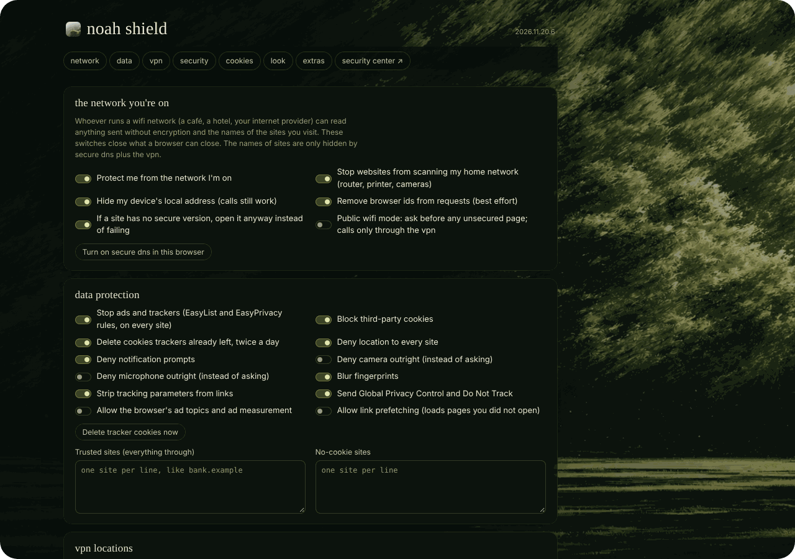 |
| 7 | **Security center** | 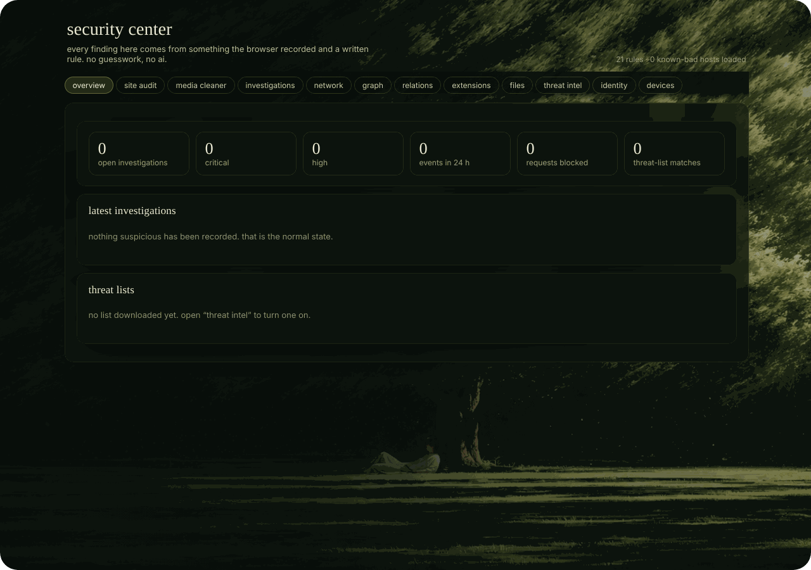 |
| 13 | **Tools** | 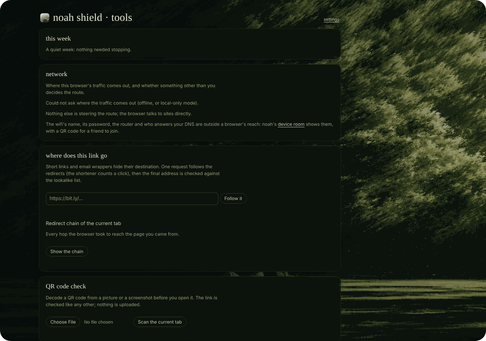 |
| 14 | **Footprint** | 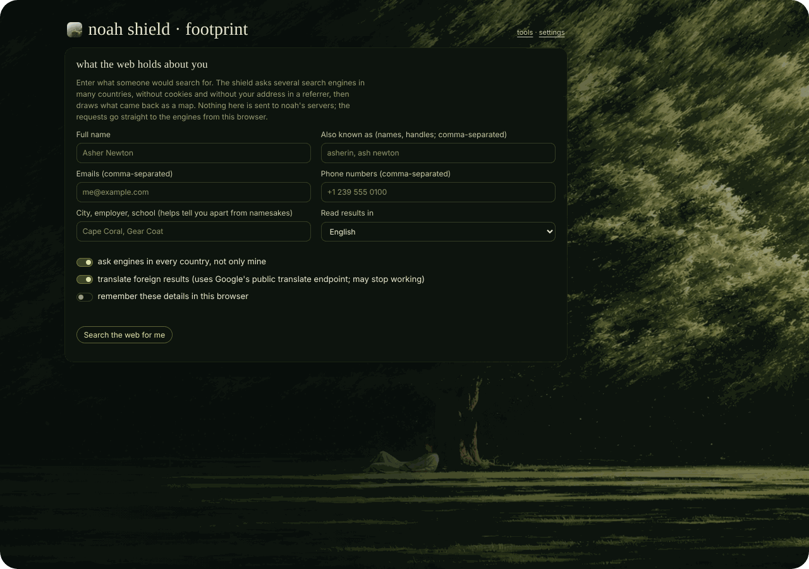 |
| 15 | **Optimizer** | 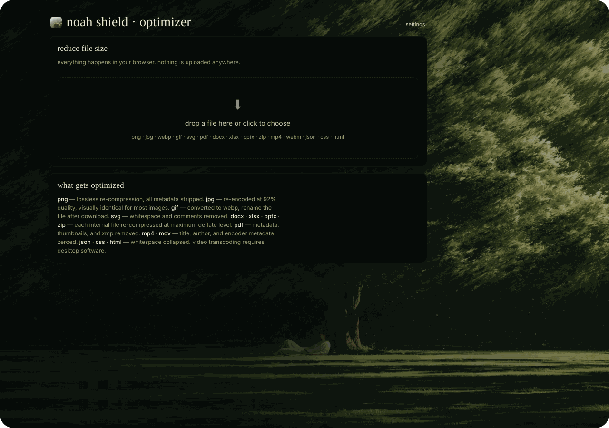 |
| 16 | **Downloader** | 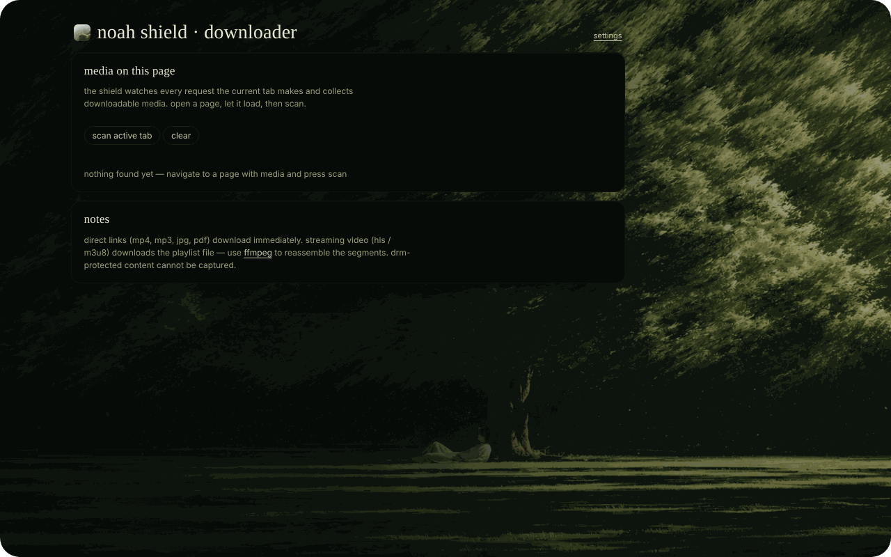 |
| 16 | **Recorder** | 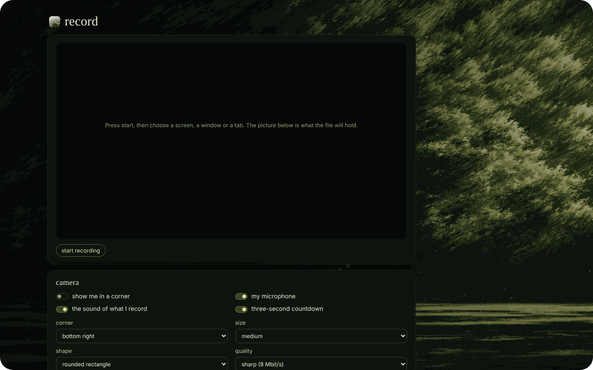 |
| 18 | **Relations side panel** | 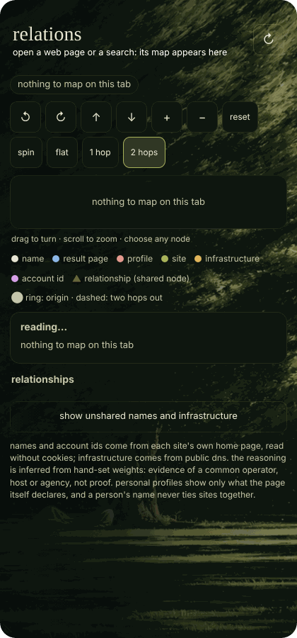 |
| 20 | **New tab** | 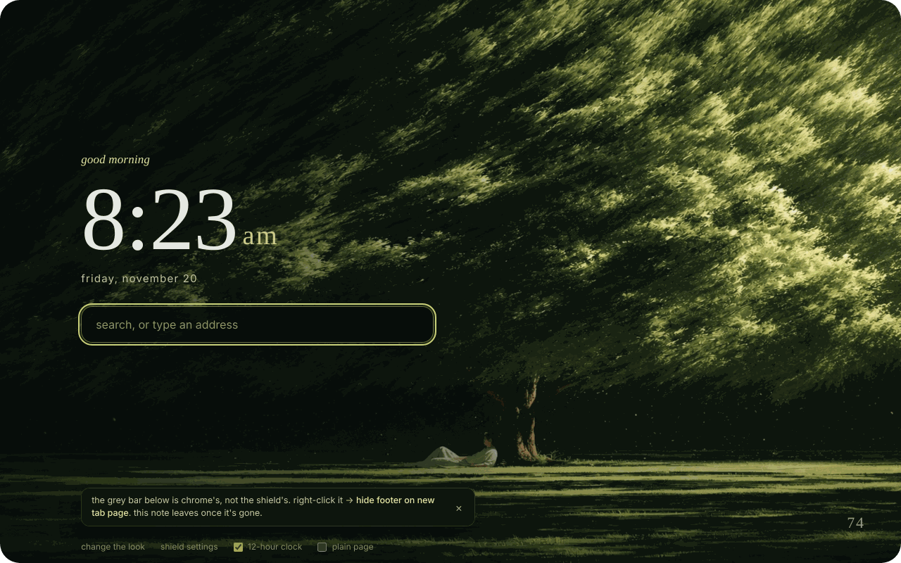 |
| 20 | **Log** | 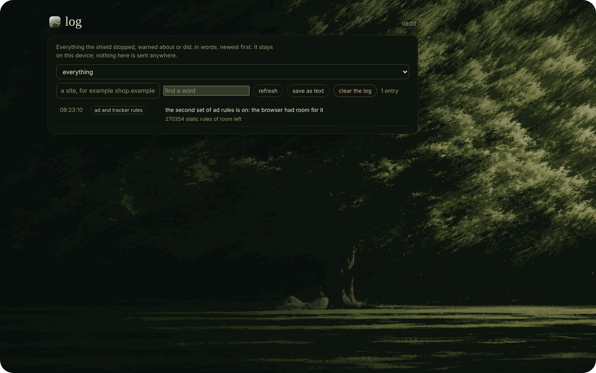 |
| 20 | **Leak test** | 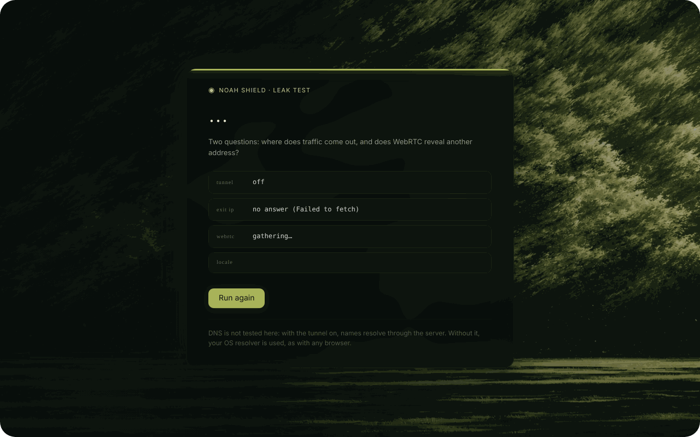 |

---

noah shield · House of Asher · <a href="https://noah.asherin.com/shield">noah.asherin.com/shield</a>

